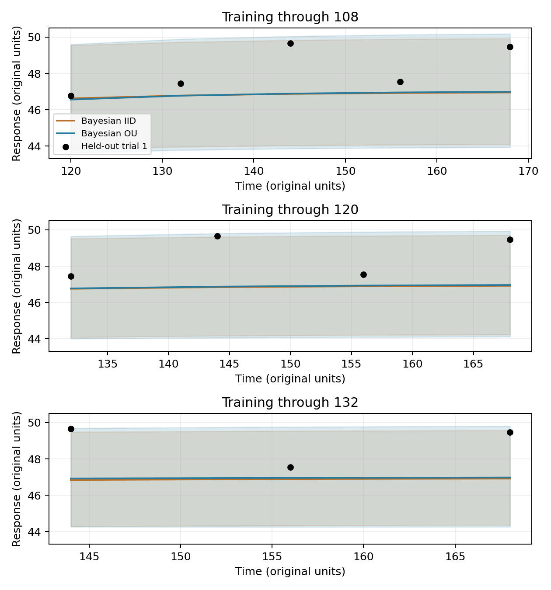
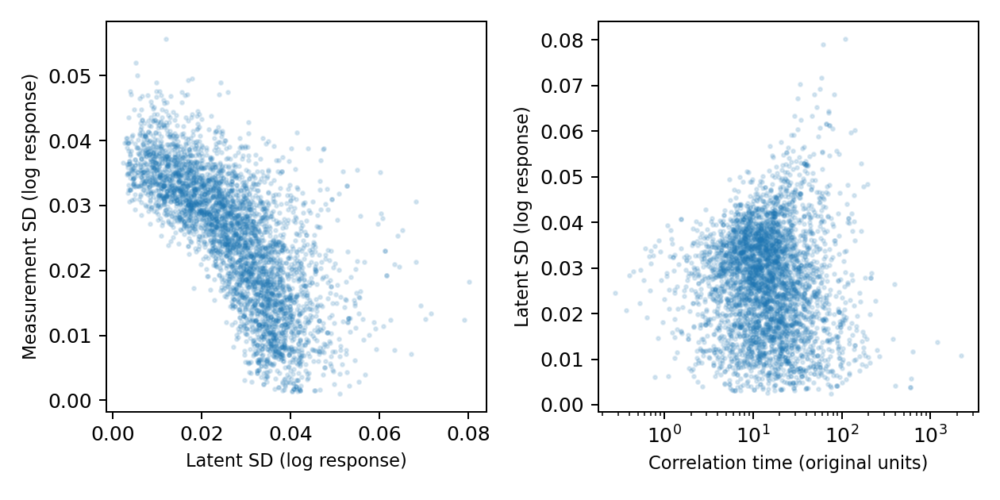

# Bayesian observation model and parameter uncertainty

Iteration date: 2026-11-25. The explicit observation-model extension is
implemented and its computational checks pass. Forecast calibration remains
an open scientific question (REV-07).

## Model and assumptions

The logistic law governs a shared population median with uncertain initial
value, rate, and capacity. Each trial has an independent stationary
Ornstein-Uhlenbeck deviation in log response, and independent Gaussian
measurement error is added in log response. The latent deviation captures
correlated departures from the population trajectory. Its stationary standard
deviation is not the diffusion coefficient of the earlier logistic SDE.

The OU states are marginalized analytically. For fixed parameters, the
log-response covariance at observed times is

```text
C[i,k] = a^2 exp(-lambda |s[i]-s[k]|) + b^2 I[i=k]
s = (t-t0)/12
```

Here `a` is latent stationary SD and `b` is measurement SD. This covariance
likelihood is exact for the stated model and has no Euler step-size parameter.
The response-scale likelihood includes the log-transformation Jacobian.
An independent scalar Kalman filter verifies the covariance calculation.

The observation-noise-only comparator sets the latent deviation to zero.
Both Bayesian models infer the initial population median, include the first
row in the likelihood, and share the same priors on their common parameters.
These choices differ from the reference classical fit's fixed trial-specific
initial conditions and additive original-scale residual criterion. Improvements
relative to that fit cannot be attributed solely to parameter uncertainty.

## Priors and units

Priors are independent normal distributions on the logarithms of the following
positive quantities. The table gives the median on the positive scale and
the standard deviation on the log scale.

| Quantity | Reference median | Log-scale SD |
| --- | ---: | ---: |
| Initial population median | 10 original response units | 1.5 |
| Capacity/initial median minus one | 3 | 1 |
| Growth rate per 12 original time units | 0.5 | 1.25 |
| OU decay per 12 original time units | 0.5 | 1.25 |
| Latent log-response SD | 0.03 | 1 |
| Measurement log-response SD | 0.03 | 1 |

These are proper exploratory analyst choices made after the earlier model
investigation, not externally elicited physical priors or a prospective
validation design. The physical units in inherited plots remain unconfirmed.
The current analysis uses original numerical units explicitly. If response
units are changed, the initial-level prior must be transformed consistently.

Priors and the fixed time scale are identical across training cutoffs. A prior
sensitivity analysis halves or doubles both noise-prior medians without
changing their widths, the likelihood, or other priors. No prior is selected
to force nominal test coverage. Pointwise prior predictive summaries are
saved in `results/bayesian/prior_predictive.csv`.

## Computational validation

Four Metropolis chains use Gaussian-mixture proposals. Covariance and scale
adaptation occur during 6000 warmup iterations and stop before retained draws.
Local curvature initializes proposals only; it does not replace the posterior
with a Gaussian approximation. The retained sample counts range from 12000
to 108000 per chain, with longer runs required for some noise tails.

All 16 model/prior/cutoff cases meet the predeclared checks:

- Maximum rank-normalized/folded split R-hat: 1.0070, below 1.01.
- Minimum bulk ESS: 641, above 400.
- Minimum tail ESS: 443.5, above 400.

The diagnostics monitor both transformed and reported parameters. They are
finite-run checks, not proofs of convergence or model adequacy. The sampler
also recovers a known correlated Gaussian target in tests. The likelihood is
checked against an independent Kalman implementation, conditional variances
against the exact OU propagation law, and fixed-parameter predictive quantities
against analytic lognormal means, quantiles, and densities.

Posterior predictive intervals solve the Gaussian-mixture CDF on the log
scale and transform the quantiles back to the response scale. This
Rao-Blackwellization avoids classification changes caused by a finite sample
of simulated measurement errors. Posterior integration still has MCMC error;
the convergence checks do not eliminate it. Predictions average over a fixed,
evenly spaced subset of 12000 retained parameter draws.

## Time-based forecasting

The same cutoffs 108, 120, and 132 are used as in REV-07. Training data alone
enter each posterior; no future response is used for scaling, likelihood, or
parameter fitting. The fixed scale of 12 time units keeps priors comparable
across cutoffs. Predictions condition on all training observations and
integrate latent states, parameters, and future measurement error.

| Model | Cutoff | RMSE | 90% predictive coverage | Mean width |
| --- | ---: | ---: | ---: | ---: |
| Observation noise only | 108 | 2.1863 | 0.8667 | 5.7894 |
| Observation noise only | 120 | 2.4573 | 0.6667 | 5.4563 |
| Observation noise only | 132 | 2.7962 | 0.5556 | 5.2120 |
| OU latent deviation + observation noise | 108 | 2.1564 | 0.8667 | 6.1572 |
| OU latent deviation + observation noise | 120 | 2.4238 | 0.8333 | 5.7518 |
| OU latent deviation + observation noise | 132 | 2.7692 | 0.6667 | 5.4952 |

The definitive values are generated from the saved CSVs for the LaTeX report.
Cutoff-weighted aggregate coverage is 0.8056 for the OU model and 0.7222 for
observation noise alone. OU aggregate RMSE is 2.4110 and mean width is 5.8566.
The same OU model with coefficients fixed at their marginal posterior medians
has 0.6944 coverage. This comparison isolates a parameter plug-in within that
model; it does not hold every feature of the earlier classical or neural
models fixed.



The three forecast splits reuse only 15 distinct scalar responses across
36 forecast entries. Weighted averages describe these retrospective forecasts;
they are not estimates based on 36 independent validation observations.
The full-data posterior predictive check additionally conditions on the data
being checked and must not be interpreted as a forecasting score.

All seven uncovered OU forecast entries are above their upper bounds.
Mean observed-minus-predicted residuals are 1.2767, 1.6641, and 2.2462 for
cutoffs 108, 120, and 132. This supports investigating structural
underprediction. A mixture-integration check at cutoff 132 using 6000, 12000,
and 24000 posterior draws leaves coverage unchanged; endpoint shifts are at
most approximately 0.012 response units relative to the 6000-draw calculation.

## Prior sensitivity and identifiability

| Noise-prior medians | Aggregate coverage | RMSE | Mean width |
| --- | ---: | ---: | ---: |
| Half reference | 0.7778 | 2.4116 | 5.6955 |
| Reference | 0.8056 | 2.4110 | 5.8566 |
| Double reference | 0.8333 | 2.4014 | 6.0513 |

Full-data reference OU marginal 90% credible intervals include:

- Capacity: median 48.0121, interval [47.1774, 49.0498].
- Growth rate per original time unit: median 0.045571, interval
  [0.042675, 0.048351].
- Latent log-response SD: median 0.027638, interval [0.008045, 0.044652].
- Measurement log-response SD: median 0.026577, interval [0.007456, 0.039392].
- Correlation time in original time units: median 13.9706, interval
  [3.2723, 70.6800].

The joint posterior correlation between the two noise SDs is about -0.72.
The noise split and correlation time are weakly identified even though the
sampling diagnostics pass. These parameter credible intervals differ from
prediction intervals for a new noisy response.



On the log scale, the forecast variance decomposition records the posterior
variance of the conditional mean, expected conditional latent variance, and
expected measurement variance. These three components follow the law of
total variance; inferred parameter dependence is retained. Forecast densities
integrate the full mixture. The marginal and joint predictive scores are
distinct from the earlier Gaussian moment proxies and from Bayesian evidence.

## Decision and reproduction

The explicit observation model and parameter integration improve the tested
uncertainty description, but do not establish nominal 90% calibration. REV-07
remains open. The next scientific work should assess structural discrepancy
and validation on additional trajectories, rather than force coverage by
increasing noise. A shared discrepancy across trials is a distinct modeling
hypothesis; the current model assumes independent trial deviations.

```sh
pip install -e ".[bayes]"
python scripts/run_bayesian_iteration.py
```

The runner checks convergence and extends failing runs before generating
tables and figures. To regenerate predictions and report artifacts from
validated local posterior files:

```sh
python scripts/run_bayesian_iteration.py --reuse-validated
```

Reuse validates the data, target and sampler hashes, settings, and posterior
shape. Posterior archives are git-ignored and can be regenerated. Summary CSVs,
diagnostics, settings, source hashes, prior predictive summaries, and figures
are retained under `results/bayesian/`. The LaTeX report includes both this
iteration and the earlier controlled calibration investigation in dedicated
sections. The original user PDF is preserved; a separate updated PDF is built.

Method references: [Stuart (2010)](https://doi.org/10.1017/S0962492910000061),
[Särkkä and Solin (2019)](https://users.aalto.fi/~ssarkka/pub/sde_book.pdf), and
[Vehtari et al. (2021)](https://doi.org/10.1214/20-BA1221).
## Predictive-moment qualification from REV-11

The unbounded lognormal priors on noise SDs give an infinite full
response-scale predictive mean. The historical mean curves and mean-based
RMSE/bias values below are finite posterior-subset diagnostics. Their finite
values and stable interval endpoints do not establish a finite response
expectation. Predictive quantiles and density scores retain their
distributional interpretation. The [prospective validation notes](prospective-validation.md#predictive-moment-audit)
give the tail argument; the new scoring API uses the predictive median for
point errors. This qualification does not replace the priors or refit the
historical experiments.
