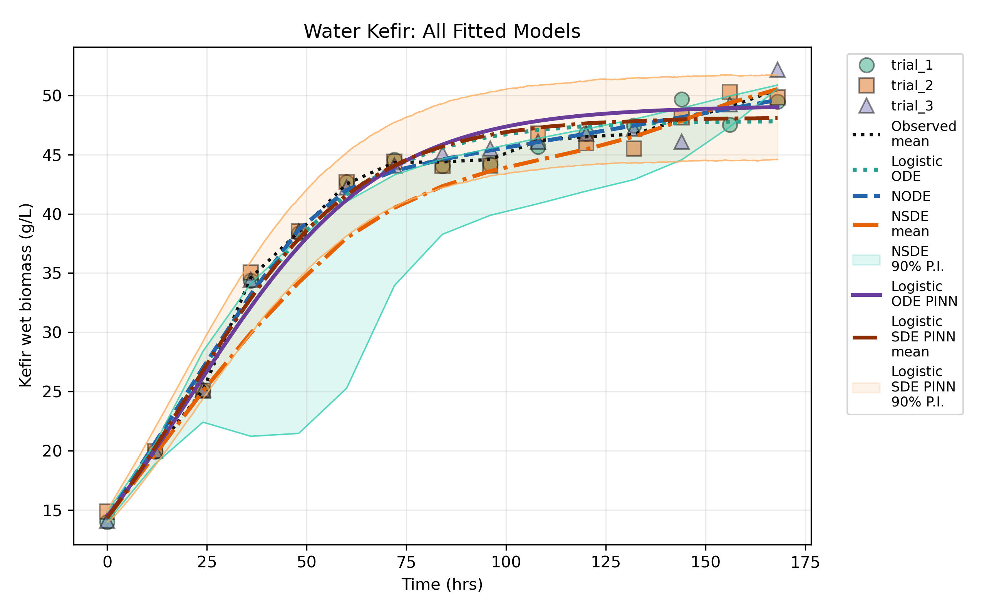
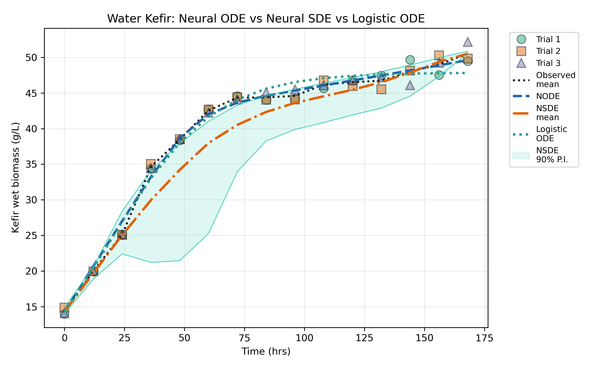
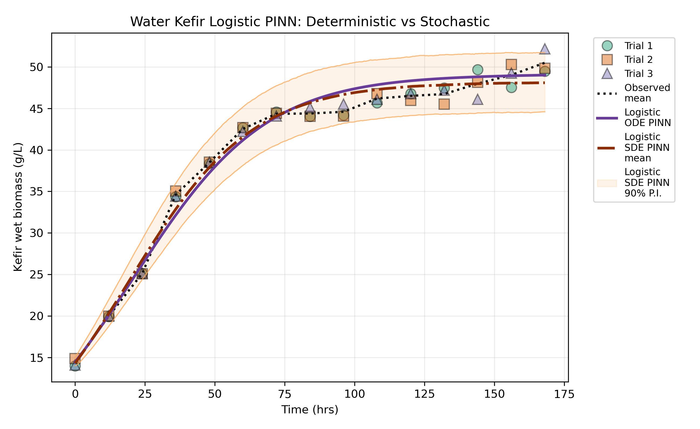
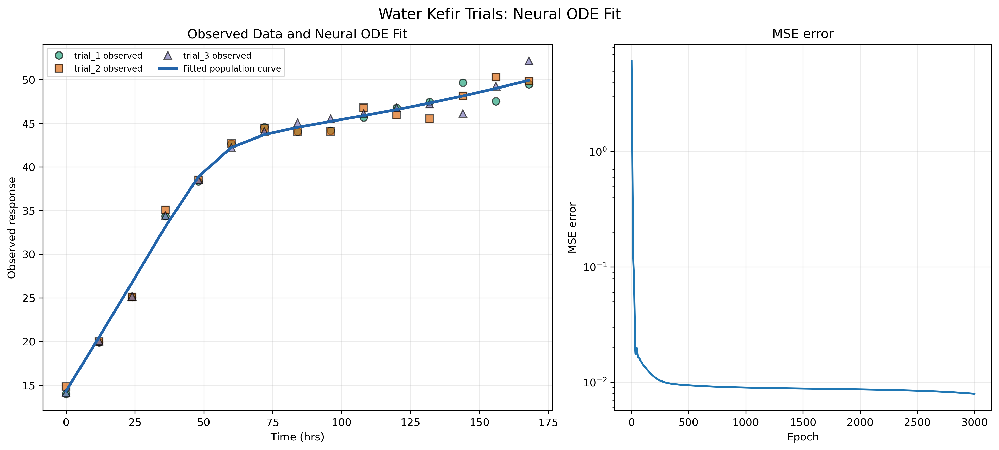
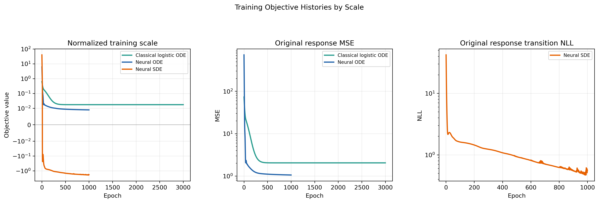

# Results

Curated figures from the water kefir experiments. The full-resolution images and
the step-by-step sequence frames are in the repository under `results/`.

## Summary metrics

In-sample fit quality on the original response scale:

The reference reproduction script updates this table and the matching figures.
Stochastic intervals condition on fitted parameters. The refined Neural SDE
rollout has poor empirical coverage; a good one-step transition fit does not
establish calibration of a continuous-time simulation.
The [controlled calibration investigation](rev07-calibration.md) compares
transition refinement, model size, regularization, and time-based forecasting.

| Model | RMSE | R² |
| --- | --- | --- |
| Classical Logistic ODE | 1.4291 | 0.9826 |
| Neural ODE | 1.0281 | 0.9910 |
| Neural SDE | 2.4769 | 0.9478 |
| Deterministic Logistic PINN | 1.6037 | 0.9781 |
| Stochastic Logistic PINN Drift | 1.4357 | 0.9825 |
| Stochastic Logistic SDE Mean | 1.4332 | 0.9825 |

## All-model comparison

## Neural ODE vs Neural SDE vs logistic ODE

## Logistic PINN comparison

## Single Neural ODE fit

## Training objectives

