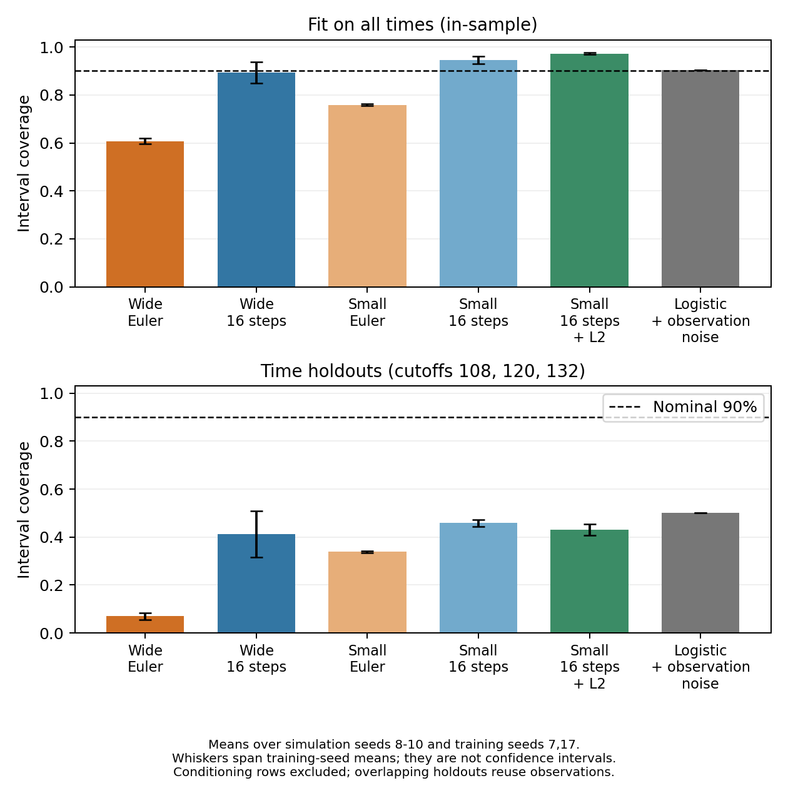

# REV-07: transition accuracy and predictive calibration

Investigation date: 2026-11-25. The transition mismatch is diagnosed; calibrated
forecasting remains unresolved. No experimental candidate has been promoted
to replace the report's reference Neural SDE.

## What the frozen-model experiment establishes

The reference coefficients were held fixed. Each of the 42 observed transitions
was simulated conditionally from its observed starting state, using 5000 paths,
three random seeds, and 1, 16, or 64 Euler-Maruyama substeps. This isolates
numerical rollout from training and parameter selection.

| Substeps per observation interval | Conditional RMSE | Conditional 90% coverage | RMS mean shift from Euler transition |
| ---: | ---: | ---: | ---: |
| 1 | 1.2794 | 0.9365 | 0.0153 |
| 16 | 1.5143 | 0.5159 | 0.6735 |
| 64 | 1.5308 | 0.5079 | 0.6838 |

Values average the simulation seeds. The one-step shift is Monte Carlo error
relative to the analytic Euler mean. The much larger refined shift persists
when the interval is subdivided further. The original transition objective is
therefore fitting a different finite-step behavior from the refined diffusion.

At the observed states, the local drift derivative multiplied by the
observation gap ranges from -3.656 to 0.037. Six of the 42 transitions have
this quantity below -2: their frozen negative linear drift lies outside the
explicit-Euler stability interval. This is a local linearization diagnostic,
not a global nonlinear stability theorem or a complete explanation of every
forecast failure. It provides a concrete mechanism for the coarse transition
and continuous-time behavior to disagree. The distinction between numerical
step error and stochastic approximation follows the framework described by
[Higham (2001)](https://webhomes.maths.ed.ac.uk/~dhigham/Publications/P42.pdf).

Raw evidence: `results/rev07/frozen/transitions.csv` and `diagnostics.json`.

## Controlled changes to the transition fit

The experiment fixes five neural candidates before evaluating the holdouts:

| Candidate | Coefficient architecture | Trainable parameters | Training transition | Weight decay |
| --- | --- | ---: | --- | ---: |
| Wide Euler | 32 units, two hidden layers | 2370 | One Euler step | 0.0001 |
| Wide moments | 32 units, two hidden layers | 2370 | 16 moment substeps | 0.0001 |
| Small Euler | 8 units, one hidden layer | 66 | One Euler step | 0.0001 |
| Small moments | 8 units, one hidden layer | 66 | 16 moment substeps | 0.0001 |
| Small moments + L2 | 8 units, one hidden layer | 66 | 16 moment substeps | 0.01 |

Every neural candidate assumes observed values are exact process states,
independent Brownian drivers across trials, and Markov transitions conditional
on the preceding state. There is no separately estimated observation error.
The likelihood is a product of conditional transition approximations, rather
than an assumption that all longitudinal responses are independent.

All fits use 1000 Adam epochs, learning rate 0.005, the existing positive
diffusion parameterization, and gradient clipping at 10. Training seeds are
7 and 17, reset immediately before initializing each candidate. These are
matched-initialization controls; they are not the exact reference checkpoint,
whose random-number stream was consumed by preceding Neural ODE training.

The new transition method approximates the evolving distribution by a
Gaussian. At each internal step, three-point Gaussian quadrature propagates
the mean and variance of the Euler update using total expectation and total
variance. It includes drift variation and diffusion variation across the
quadrature states. Variance remains nonnegative by construction. The legacy
variance floor is added once at the end of an observation interval.

This is an experimental Gaussian assumed-density transition approximation,
related to the methods in
[Särkkä and Solin, Section 9.1](https://users.aalto.fi/~ssarkka/pub/sde_book.pdf).
It is not an exact nonlinear transition density. Smaller steps do not remove
Gaussian closure error. Unit tests check recovery of the original one-step
objective and gradients, Ornstein-Uhlenbeck and geometric-Brownian moments,
and finite multistep parameter gradients.

For the full-data small moment fit, an independent 5000-path conditional
simulation gives 0.9524 coverage at both 16 and 64 substeps. At 64 substeps,
the Gaussian closure's conditional mean differs from the Monte Carlo mean
by 0.0157 RMS response units; maximum pointwise Monte Carlo mean standard
error is about 0.0316. This supports that approximation in this specific fit,
without establishing exact transition densities or forecast calibration.

## Time-based validation

Three separate fits train through times 108, 120, and 132 and forecast all
remaining observations. Each fit computes response normalization and time
scaling from its training rows only. Forecast time retains that training
origin and scale; future normalized times may exceed one.

Free forecasts start from the last observed training state and never restart
at later test observations. Separate one-step conditional diagnostics do
condition on the preceding observed test state; their scores are labeled
separately. The initial conditioning row is excluded from every rollout
coverage statistic. No hyperparameter is selected using these test results.

Each neural fit is simulated with 2000 paths and simulation seeds 8, 9, and
10, with maximum normalized step 0.001. The classical comparator uses its
exact logistic trajectory and a Gaussian observation variance estimated from
training residuals. This comparator changes both the dynamics family and
observation model, so it does not isolate measurement noise as the cause.
All predictive bands condition on parameter point estimates.

| Candidate | Full-data rollout coverage | Held-out rollout coverage | Held-out RMSE | Held-out mean width |
| --- | ---: | ---: | ---: | ---: |
| Wide Euler | 0.6071 | 0.0694 | 3.1357 | 1.4974 |
| Wide moments | 0.8929 | 0.4120 | 2.1000 | 2.5063 |
| Small Euler | 0.7579 | 0.3380 | 1.5335 | 1.4451 |
| Small moments | 0.9444 | 0.4583 | 1.6204 | 2.2985 |
| Small moments + L2 | 0.9722 | 0.4306 | 1.9365 | 2.5716 |
| Logistic + observation noise | 0.9048 | 0.5000 | 2.6531 | 3.3983 |

The table averages simulation seeds and then training seeds. Within a training
seed, holdout entries are weighted by their count across the three cutoffs.
RMSE is pooled by squared error within a training seed, then averaged across
training seeds. The cutoffs yield 36 overlapping forecast entries but reuse
only 15 distinct observed scalar responses. These are descriptive averages,
not 36 independent validation observations. There are no binomial confidence
intervals or independent-sample claims.



The small moment model's held-out coverage falls from 0.6667 for cutoff 108
to 0.4167 for cutoff 120 and 0.1667 for cutoff 132. Its apparently good
full-data calibration does not generalize to these retrospective forecasts.
Stronger regularization does not solve this failure, and the observation-noise
comparator also undercovers. Numerical refinement and parameter-count reduction
are useful corrections, but they do not establish a scientifically adequate
forecast model.

The CSVs also contain Gaussian moment-based negative log predictive scores.
For neural forecasts these are Gaussian proxies computed from simulated means
and variances, not exact predictive densities or joint trajectory likelihoods.
For the classical Gaussian observation model, its marginal Gaussian score is
exact conditional on the fitted trajectory and variance. These scores do not
include parameter uncertainty and are not marginal likelihoods.

## Decision and remaining work

REV-07 remains open because its forecasting-calibration acceptance criterion
has not been met. The numerical transition mismatch has a controlled
demonstration, and the refined transition is a tested experimental option.
Neither near-nominal in-sample coverage nor wider intervals justifies promoting
it as a calibrated replacement.

The next modeling iteration should specify a latent-process observation model
and assess parameter uncertainty and structural discrepancy. A Bayesian
extension would require explicit priors, an observation likelihood, validated
posterior computation, and posterior predictive checks. The present experiment
does not uniquely identify whether observation error, process specification,
parameter uncertainty, or changing late-time dynamics dominates the remaining
forecast error. Confirm the inherited time/response units before setting
physical-scale priors. Do not inflate diffusion to force nominal coverage.

## Reproduction and artifacts

First create the reference checkpoint, then run the investigation:

```sh
python scripts/reproduce_report.py
python scripts/run_rev07.py
```

The second command executes all candidates, cutoffs, and training seeds, both
frozen-transition diagnostics, and the aggregate figure. It saves experimental
outputs under `results/rev07/`; it does not replace the reference report's
model tables or PDF. Effective settings, source hashes, data hash, and versions
are saved in each cutoff's `experiment.json`. Checkpoints are git-ignored.

Important artifacts are `all_metrics.csv`, `by_fit.csv`,
`holdout_summary.csv`, `calibration_summary.png`, the per-candidate forecast
CSVs, training histories, and the two frozen-diagnostic directories.
Individual completed fits can be re-evaluated with `investigate_rev07.py
--reuse-fits` and matching cutoff, seed, epoch count, and output directory.

Validation: 62 unit tests pass, including tests that future responses cannot
change training normalization and that forecasting preserves the time origin.
